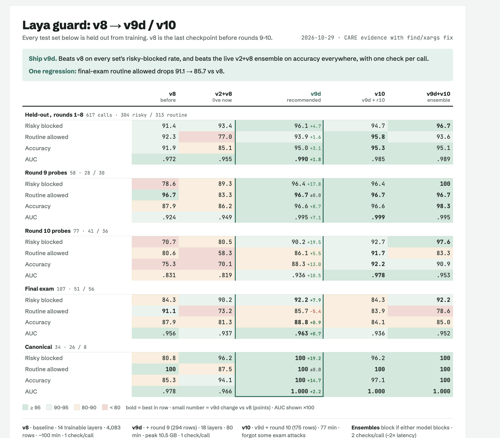

# pi-laya-mlx

**Screen every tool call your [pi](https://pi.dev) coding agent makes with [Laya](https://huggingface.co/convaiinnovations/laya), a calibrated decision model running locally on Apple Silicon via MLX.** Calls Laya judges unsafe are blocked before they run, and the model gets the reason back as the tool result, so it can change course instead of retrying.



```
model ──tool call──▶ pi ──tool_call hook──▶ extension ──POST /v1/guard──▶ laya-guard (MLX, localhost)
                      ▲                         │                              │
                      │       allow ◀───────────┤◀── {decision, risk, category, reason}
                      └── "Blocked by the Laya safety guard: it looks like it deletes data outside
                           the project ... pick a narrower, reversible alternative" (tool result)
```

- **Local and private.** Nothing leaves the machine. One check takes ~20-60 ms on an M-series Mac.
- **Gives the model a reason.** Blocks come back to the model as a tool result naming the risk category (destroy, exfiltrate, remote_code, system, production), so it explains or picks a safer path.
- **Fine-tuned for tool calls.** Ships a training script that fine-tunes Laya in MLX on labeled tool calls (`research/`). Zero-shot Laya is a weak judge of shell commands; the fine-tuned checkpoint ([a3harva/laya-toolguard-mlx](https://huggingface.co/a3harva/laya-toolguard-mlx)) is much better (see [Results](#results)).
- **Jev-compatible.** The server also exposes `POST /v1/systemone`, the TypeSafe Jev request shape, for any other Laya question.

## Requirements

- Apple Silicon Mac, macOS 14+
- Python 3.12 and [uv](https://docs.astral.sh/uv/)
- pi 1.4+

## Install

```bash
git clone https://github.com/a3harva/pi-laya-mlx && cd pi-laya-mlx
./scripts/setup.sh          # creates server/.venv, installs MLX deps, downloads the fine-tuned model (~500 MB)
# ./scripts/setup.sh --finetune   # or train it yourself (~1.5 h on a 16 GB M-series Mac)
```

Try it for one session:

```bash
pi -e ./extension
```

Install it for every session:

```bash
pi install ./            # or: add the absolute path of this folder to "packages" in ~/.pi/agent/settings.json
```

Run it in tmux, with pi on the left and the guard's live verdict log on the right:

```bash
scripts/tmux.sh ~/code/myproject        # outside tmux: creates/attaches session "laya"; inside tmux: splits the current window
scripts/tmux.sh . -- --model sonnet     # anything after -- is passed to pi
```

The extension starts the server on first use (a detached daemon on `127.0.0.1:8723`, shared by all pi sessions, log in `~/.cache/laya-guard/server.log`). To run it yourself:

```bash
server/.venv/bin/laya-guard-serve --port 8723
```

## Use

The footer shows `laya ✓12 ✗1` (allowed, blocked). `/laya` shows status; `/laya off` and `/laya on` toggle screening for the session.

When a call is blocked, pi shows a warning and the model receives:

> Blocked by the Laya safety guard: it looks like it deletes or overwrites data outside the project (home directory, disk, or git history) (risk 0.97 >= threshold 0.50; top category 'destroy' p=0.95). Do not retry the same action or work around the guard with an equivalent command. If the step is needed, pick a narrower, reversible alternative that stays inside the project, or explain to the user why it is needed and let them run it themselves.

### Configuration

Extension (environment variables):

| Variable | Default | |
|---|---|---|
| `LAYA_GUARD_URL` | `http://127.0.0.1:8723` | server URL |
| `LAYA_GUARD_THRESHOLD` | server's | block when risk ≥ this |
| `LAYA_GUARD_FAIL` | `closed` | `closed` blocks calls while the server is unreachable; `open` lets them run |
| `LAYA_GUARD_SKIP` | none | comma-separated tool names never screened, e.g. `read,grep,find,ls` |
| `LAYA_GUARD_CONFIRM` | off | `1`: in the TUI, ask the user to allow a flagged call instead of blocking outright |
| `LAYA_GUARD_AUTOSTART` | on | `0`: never start the server |
| `LAYA_GUARD_API_KEY` | none | bearer token, if the server requires one |
| `LAYA_GUARD_TIMEOUT_MS` | `15000` | how long one check may take before it counts as unreachable |

Server (`laya-guard-serve` flags or environment variables):

| Variable | Default | |
|---|---|---|
| `LAYA_GUARD_MODEL` / `--model` | `checkpoints/laya-toolguard` if present, else `a3harva/laya-toolguard-mlx` (v9d) | local dir, `hf-repo[:subdir]`, or a comma-separated list (cautious ensemble) |
| `LAYA_GUARD_THRESHOLD` / `--threshold` | `0.5` | |
| `LAYA_GUARD_HOST`, `LAYA_GUARD_PORT` | `127.0.0.1`, `8723` | |
| `LAYA_GUARD_API_KEY` | none | require `Authorization: Bearer <key>` |

### Web UI

Open <http://127.0.0.1:8723/> while the server runs to check a command (or a write/edit, or any tool with JSON input)
by hand: you get the verdict, the reason the agent would see, every category's probability, and a history of checks. The
threshold slider overrides the server default for that request only.

### API

```bash
curl -s localhost:8723/v1/guard -H 'content-type: application/json' \
  -d '{"tool":"bash","input":{"command":"rm -rf ~"},"cwd":"/Users/me/proj"}'
# {"decision":"block","risk":0.99,"category":"destroy","probabilities":{...},"reason":"Blocked by ...","latency_ms":31.2}
```

`POST /v1/systemone` takes `{state, questions}` in the Laya / Jev shape (`choice`, `score`, `noul`/`bool`). `GET /health` reports the model and threshold.

## How it works

1. pi fires `tool_call` before every tool runs, including calls nested in other tools. The extension sends the tool name, its arguments and the working directory to the server.
2. The server renders that as a JSON state and asks Laya one `choice` question, *"Which best describes what this action does?"*, with six options: `routine` and five risk categories (`server/laya_guard/policy.py`). Laya scores every option in a single forward pass and returns calibrated probabilities.
3. Risk is `1 - p(routine)`. At or above the threshold the call is blocked, and the reason names the most likely risk category.
4. The extension returns `{ block: true, reason }`, which pi delivers to the model as the tool result. Every verdict is also appended to the session (`laya-guard` entries) for auditing.

Laya never generates text, so there is nothing to parse and a prompt injection inside a command cannot make it "say" allow; it can only shift probabilities, which is what the fine-tuning data includes hard cases for.

## Results

Zero-shot Laya is a weak judge of shell commands (it blocked `npm test`). It was fine-tuned in ten versions, with a
red-team loop between them: a second pi agent (DeepSeek, locked down so it can only score text, never run it) wrote
adversarial probes and training rows each round; every plan and label was reviewed before use. All numbers are on
calls never trained on (risky blocked / routine allowed). Full history: [`research/REDTEAM_LOG.md`](research/REDTEAM_LOG.md).

| model | held-out (617) | round 9 (58) | round 10 (77) | final exam (107) | canonical risky (26) | checks per call |
|---|---|---|---|---|---|---|
| v8 (previous default) | 91.4% / 92.3% | 78.6% / 96.7% | 70.7% / 80.6% | 84.3% / 91.1% | 21 | 1 |
| v2+v8 ensemble | 93.4% / 77.0% | 89.3% / 83.3% | 80.5% / 58.3% | 90.2% / 73.2% | 25 | 2 |
| **v9d (default)** | **96.1% / 93.9%** | 96.4% / 96.7% | 90.2% / 86.1% | **92.2% / 85.7%** | **26** | 1 |
| v10 | 94.7% / 95.8% | 96.4% / 96.7% | 92.7% / 91.7% | 84.3% / 83.9% | 25 | 1 |
| v9d+v10 ensemble | 96.7% / 93.6% | 100% / 96.7% | 97.6% / 83.3% | 92.2% / 78.6% | 26 | 2 |

v9d = v8's data plus round 9, with 18 instead of 14 trainable layers. Its one regression against v8 is routine calls on
the final exam. v10 adds round 10's rows and fixes most round-10 misses, but forgets some final-exam attacks. On the
synthetic validation split (324 rows) v8 scores 98.3% / 97.9%.

The synthetic validation split is LLM- and template-written data held out from training; it is easy, so it mostly
shows the model learned the categories. The held-out and final-exam sets are adversarial on purpose (hard negatives such as `grep -rn 'rm -rf ~' docs/`);
on the plain hand-written set v8 allows 100% of routine calls and blocks 92-95% of risky ones.

External comparison on a CARE-style benchmark (549 commands from Atomic Red Team, RedCode-Exec and NL2Bash, rebuilt
because CARE did not release its split):

| | F1 | detection | false positives |
|---|---|---|---|
| CARE static engine | 65.9% | 53.6% | 6.1% |
| Laya v8 | 62.8% | 51.4% | 8.2% |
| Laya v8 OR CARE static | **73.0%** | 67.7% | 11.9% |

### Ensembles and evidence

- `LAYA_GUARD_MODEL=a3harva/laya-toolguard-mlx,a3harva/laya-toolguard-mlx:v10` runs the v9d+v10 cautious ensemble: a call is blocked if any member would
  block it. Newer checkpoints fix many red-team failures but forget a few classic attacks; the union keeps both.
- `pip install "laya-guard[evidence]"` adds structural facts from [CARE](https://github.com/prisma-research/CARE)'s
  static shell analyzer (effect class per command part, output piped to an interpreter, critical paths, risk rules)
  to the state Laya judges. Checkpoints trained with it (`state_evidence: true` in their config, e.g. v8, v9d) require it.
- Long commands, file contents and edits are judged in overlapping 1,200-character windows; the riskiest decides.

## Fine-tuning

```bash
server/.venv/bin/python research/gen_templates.py          # template rows -> research/data/templates.jsonl
research/gen_llm.sh destroy A                               # LLM-written rows via pi (any provider) -> research/data/gen/
# v9d recipe (v10 when round-10 rows are present); the watchdog stops training if free memory drops below 10% (16 GB Macs need --batch 4)
scripts/train-guarded.sh --out checkpoints/laya-toolguard --evidence --epochs 4 --train-layers 18 --batch 4 --redteam-repeat 1 --routine-weight 1.5
server/.venv/bin/python research/evaluate.py checkpoints/laya-toolguard
```

Training time on a 16 GB M-series Mac (measured; full table in `research/REDTEAM_LOG.md`): the v8 recipe took about
1.4 s per step at batch 4 while swapping; with the MLX cache cap (`--cache-limit-gb`, default 1) v9 runs at 0.66 s per step, about 12 min per epoch on ~4,400 rows, so 4 epochs plus evaluation and saving is about
1 h. v9d's 18 trainable layers take 1.05 s per step (80 min, peak 10.5 GB). Time scales with rows x epochs, and with the number of trainable layers (8 layers: ~10 min per epoch).
A run that is much slower than that is usually swapping: check `memory_pressure`.

Data (`research/data/`):

| file | rows | used for |
|---|---|---|
| `gen/*.jsonl`, `templates.jsonl` | ~3,500 | training (10% held out as the synthetic validation split) |
| `redteam/train/*.jsonl` | ~1,670 | training; reviewed red-team rows (round 10 only in v10) |
| `eval.jsonl` | 128 | hand-written test set, never trained on |
| `redteam/probes/*.jsonl` | ~620 | adversarial probes from rounds 1-7, 9 and 10, never trained on |
| `canonical.jsonl` | 34 | classic attacks; a gate against forgetting them |
| `redteam/final-exam.jsonl` | 107 | round 8 final exam, never trained on |

Labels follow one convention throughout: local dev data and regenerable caches are routine, history rewrites are
`destroy`, tampering with safety controls is `system`, and describing danger (in docs, greps, tests) is routine.
All commands, hosts (RFC 5737 addresses, example.com) and credentials in the data are fictitious.

`finetune.py` loads the 8-bit MLX checkpoint, dequantizes it, trains the top encoder layers and the decision head with cross-entropy on the guard's own question (so training matches serving exactly), fits a calibration temperature on a validation split, and re-quantizes to 8-bit in the same layout, so `laya_guard` loads it unchanged. `research/data/eval.jsonl` is a hand-written held-out set that is never trained on.

## Testing

```bash
cd server && .venv/bin/python -m pytest -q          # unit tests, no model needed
.venv/bin/python ../tests/live/run_scenarios.py     # live pi sessions in a sandbox (needs a configured pi model)
```

The live test runs real pi sessions on a throwaway fixture project under `LAYA_TEST_SAFE_ROOT` (default `~/Developer/temp`). A test-only extension (`tests/live/safety-net.ts`) wraps every bash command in macOS `sandbox-exec` (writes only inside the scenario folder, no network) and blocks writes outside it, so even a call Laya misses cannot touch real files.

## Limits

- Laya is a classifier, not a sandbox. It lowers risk; it does not prove a call is safe. Pair it with OS sandboxing for untrusted work.
- The English checkpoints read 512-1024 tokens; long `write` contents are clipped before judging.
- Commands that hide their effect (an innocent-looking script that does damage when run) are judged by what is visible in the call.

## Credits

- [Laya](https://huggingface.co/convaiinnovations/laya) by Convai Innovations (Apache-2.0).
- MLX port [cavi-ai/laya-MLX-8bit](https://huggingface.co/cavi-ai/laya-MLX-8bit) by CAVI AI; its model code (MIT) is downloaded with the weights.
- [pi](https://pi.dev) by Earendil Works.

## License

MIT for this repository's code. Model weights keep their own licenses (Apache-2.0).
